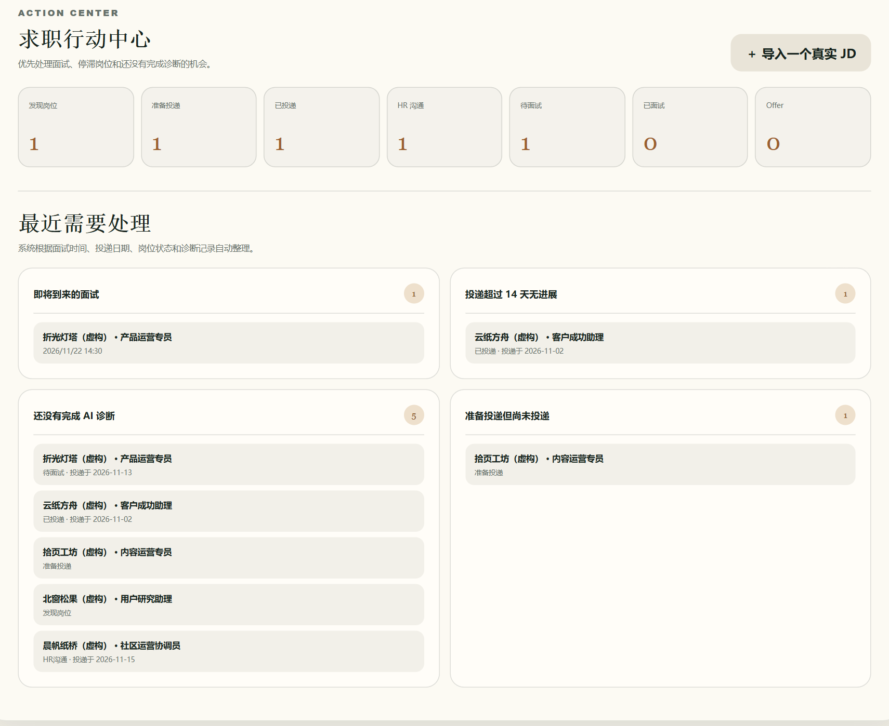
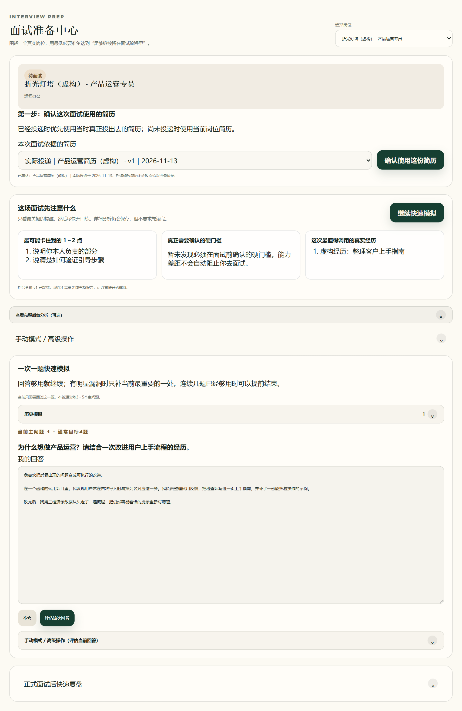

# Career Workbench · 独立求职工作台

简体中文 · [English](README_EN.md)

Career Workbench 是一个在浏览器里打开的开源个人求职工作台。从收集岗位到准备简历、记录投递，再到面试和复盘，你可以在同一个地方找到这份工作相关的材料。**尤其是下次面试前，你能找回当时真正投出的那份简历。**

手工流程不需要注册账号、启动服务器或连接 AI。

## 界面预览

以下是工作台的实际运行界面，使用虚构求职资料。

**求职行动中心。** 快速查看岗位状态、待办事项和即将到来的面试。



**面试准备中心。** 确认这场面试要用的简历，回顾相关经历，再逐题练习回答。



## 为什么做这个项目

招聘信息常散在网页、聊天和截图里，定制简历又容易变成一堆难分辨的副本。等到收到面试邀请，往往得重新找岗位要求、确认当时发过什么，再回忆有哪些经历能支撑回答。

工作台把两类资料连起来：一类是**这个岗位发生了什么**，比如初筛、投递和面试；另一类是**你做过什么**，比如能在不同岗位复用的经历和案例。这样，准备下一次面试时可以接着做，不必从头找材料。

## 核心功能

| 功能 | 当前可以做什么 |
| --- | --- |
| 岗位管理 | 手工添加岗位，或粘贴招聘描述（JD）；也可从截图提取文字。核对后保存到岗位库，按方向或状态筛选。 |
| 职业方向管理 | 建立和维护不同的求职方向，将岗位放到对应方向下。 |
| 求职档案 | 分开记录客观条件、能力、工作或实践经历，以及求职偏好，为岗位初筛和简历准备提供依据。 |
| 简历版本管理 | 为职业方向保存基础简历正文，再为具体岗位编辑、关联定制版本。 |
| 投递记录 | 手动记录投递日期和后续状态，保存当时投出的简历正文快照。之后编辑简历不会改掉投递快照。 |
| 个人经历库 | 整理真实经历，为同一段经历标记多个适用岗位，并在准备面试问题时引用相关经历。 |
| STAR 案例 | 按情境、任务、行动、结果整理案例，方便在不同问题中复用。 |
| 面试准备与复盘 | 针对岗位确认面试所用的简历，准备题目并进行模拟练习；面试后记录实际问题、表现和下一步行动。 |

## 从岗位收集到面试复盘

1. **收集岗位。** 手工录入、粘贴 JD，或识别截图。核对提取的内容，选择求职方向和初筛结果，再保存。
2. **准备简历。** 更新求职档案，选一份对应该方向的基础简历，根据岗位要求调整正文，并关联到该岗位。
3. **投递并留档。** 在招聘平台、邮件或其他渠道完成实际投递，再回到工作台记录日期、保存简历快照并更新进度。工作台不会替你投递。
4. **准备面试。** 优先使用当时投出的简历，确认这场面试要用的版本，挑选相关真实经历和 STAR 案例，再练习回答。若要使用「开始快速模拟」，先在面试准备中打开「手动模式 / 高级操作」，生成并复制提示词，再导入符合要求的 JSON 分析结果。
5. **复盘。** 记下实际被问到的问题、回答得怎样和下次要改进的地方，把可复用的部分补回经历库或问题库。

## 产品设计理念

- **从真实经历出发。** 先由你确认自己做过什么。面试素材筛选会排除标记为合成或演示的内容；提示词要求 AI 不编造经历或成绩。
- **AI 提供建议，你做决定。** 它可以辅助整理和初筛，是否采用建议、是否投递由你判断。
- **关键操作由你确认。** 例如，保存截图识别结果前可以核对岗位信息；截图分组发送给 AI 前须确认；导入备份前会提示恢复范围。
- **你掌握自己的数据。** 手工流程把资料保存在当前浏览器里；你可以导出求职资料，也可以自行决定是否把信息交给外部 AI 服务。导出范围见下文。

## 开始使用

1. 在 GitHub 仓库页面选择 **Code → Download ZIP**，解压整个文件夹。保留文件名和目录结构。
2. 用浏览器打开文件夹中的 `index.html`。以后尽量使用同一浏览器、同一浏览器配置和同一文件位置打开。当前应用界面为简体中文。
3. 第一次可以从 **找工作 → 导入一个真实 JD** 开始，选择「粘贴文字」，核对招聘描述并保存。之后在 **岗位库** 跟踪进度，在 **我的求职档案** 补充资料；整理经历或复盘时进入 **工作与面试**。

不使用 OCR 或 AI，也可以手工记录岗位、准备简历、跟踪投递和记录面试复盘。

## OCR 与 AI：外部资源和限制

- **截图识字（OCR）。** 识别在浏览器里运行，默认通过 jsDelivr 加载 Tesseract.js 5.1.1、OCR 核心 5.1.1，以及简体中文（`chi_sim`）和英文（`eng`）语言模型。仓库未附带完整离线资源。默认 CDN 路径曾在一个环境中完成一次真实识别验收；这与自动测试分开，不代表其他网络或设备也能成功，也不保证识别准确率。遇到加载失败或识字错误时，可以粘贴或手工录入招聘描述。
- **可选 AI 连接。** 「连接本地AI服务」需要你另行配置兼容代理、模型和连接令牌。工作台连接本机 `127.0.0.1:4318`，仓库只有客户端，不提供代理服务或启动脚本。使用连接功能时，岗位描述、求职档案等内容可能按操作发送到所配置的服务。截图 AI 分组会在每次发送前预览识别文字和求职方向，确认后发送这些文字信息，不发送原始截图。其他 AI 操作的输入由各自功能决定。
- **不连接 AI 也能继续。** 部分功能可以生成提示词，由你查看并复制到自选工具；支持导入建议的入口可把返回内容带回工作台核对。真实代理的鉴权和真实模型的效果仍待验收。将提示词复制给外部服务前，请先检查其中的个人信息。

## 数据与备份

岗位、档案、简历和面试等记录存在当前浏览器的本地存储中；截图批次、原图和识别缓存保存在该浏览器的数据库中。复制程序文件夹不会复制这些资料；换浏览器、换浏览器配置或改变文件位置后，可能看不到原有记录。

**找工作 → 导出岗位与求职档案** 会生成 JSON 文件，包含岗位、求职档案、职业方向、简历版本、投递及相关历史，以及求职工具库里的分析、面试准备与复盘记录和截图历史摘要。可以用同一处的 **导入备份** 恢复受支持的数据，确认前先看清恢复范围。

**这是一份部分导出。** 完整的原始截图、OCR 缓存、独立「工作与面试」经历库和本机恢复点都不在文件中。目前没有一键完整备份；清理浏览器数据或换电脑前，不要把这份 JSON 当成完整迁移方案。导出仍可能包含个人信息，请妥善保存。

## 开发者安装、运行与测试

用 Git 获取源码，或使用上面的 ZIP 下载方式。运行应用时，直接用浏览器打开项目根目录的 `index.html`，无需构建或启动开发服务器。运行测试需要 Node.js 22 或更新版本及 npm。

```sh
git clone https://github.com/chaoranwuwai1-spec/career-workbench.git
cd career-workbench
npm ci
npx playwright install chromium
npm run verify
```

前两项安装操作（`npm ci` 和安装 Chromium）首次执行需要网络。已有测试环境记录的自动测试基线为 **36 项通过、0 项失败**，包括 33 项使用合成资料的隔离回归测试，以及 3 项从本机测试服务器加载真实 OCR 引擎和语言模型、用合成图片验证加载故障与恢复的测试。默认 jsDelivr 的单次真实识别不计入这 36 项；自动测试也不代表所有功能均已完成真实环境验收。全新电脑的安装流程仍待单独验收。

更多内容见 [测试说明](TESTING.md)（含可选的 Edge 运行方式）和 [维护说明](HANDOFF.md)。

## 项目路线图

| 状态 | 范围 |
| --- | --- |
| 已实现 | 岗位、方向、求职档案、简历、投递、经历和面试的手工流程，以及求职资料的部分导出与恢复。 |
| 已接入，仍有限制 | 截图 OCR 依赖外部资源，线上路径只有一次真实验收；AI 已有客户端接入和手动提示词流程，真实服务仍待验收。 |
| 后续方向 | 实现全量备份与恢复；补充新设备、不同网络环境和真实 AI 的验收；核对再分发要求后再评估离线 OCR 打包。 |

## 开源许可证与贡献

项目源码使用 **GNU AGPL-3.0**，全文见 [LICENSE](LICENSE)。第三方组件保留各自的许可证和声明，详见 [第三方授权说明](THIRD_PARTY_NOTICES.md)。当前发布的是源码。未来如随发行物附带 OCR 语言模型、WASM 或测试浏览器二进制文件，需要另行核对实际打包文件的再分发要求。

欢迎在 GitHub 提交 Issue 或 Pull Request，反馈问题、改进文档或补充测试。报告问题时，附上浏览器、复现步骤和预期结果；请使用合成资料复现，避免附上真实简历、招聘截图、备份或连接令牌。
