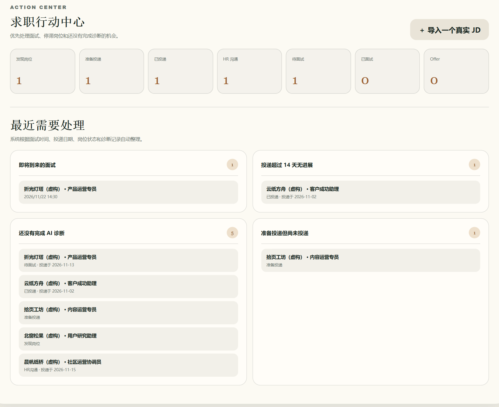
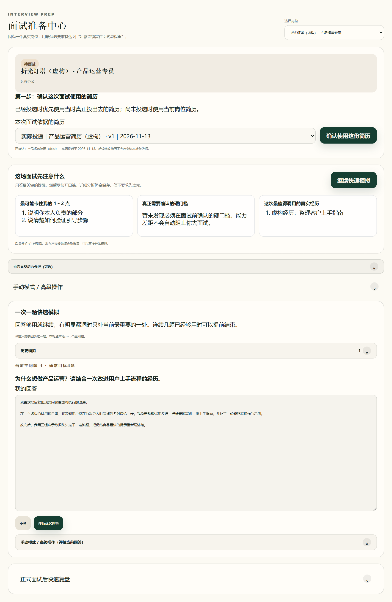

# Career Workbench

[简体中文](README.md) · English

Career Workbench is an open-source workspace for managing your job search in a browser. Collect roles, prepare resumes, record applications, and get ready for interviews and follow-up reviews. Keep the material for each role in one place. **When you get an interview, you can find the exact resume text you submitted.**

The manual workflow requires no account, server, or AI connection.

## Interface preview

These screenshots show the workbench in use with fictional job search data.

**Job Search Dashboard.** See application statuses, tasks, and upcoming interviews at a glance.



**Interview Preparation Center.** Confirm which resume to use, review relevant experience, and practice answering one question at a time.



## Why this project exists

Job descriptions end up in web pages, chats, and screenshots. Tailored resumes can turn into a pile of nearly identical files. An interview invitation often means hunting down the requirements, checking what you actually sent, and remembering which experiences would support a good answer.

Career Workbench connects two kinds of information: **what happened with this role**, from screening to application and interview, and **what you’ve done**, including experiences and examples you can reuse across roles. When the next interview comes up, you can pick up where you left off.

## Core features

| Feature | What you can do today |
| --- | --- |
| Job tracking | Add a role manually, paste a job description (JD), or extract text from screenshots. Review it before saving to the job library, then filter by career direction or status. |
| Career directions | Define and maintain different directions for your job search and assign each role to the appropriate one. |
| Job search profile | Record qualifications, skills, work or practical experience, and preferences separately to inform screening and resume preparation. |
| Resume versions | Save a base resume for a career direction, then edit and link a tailored version for a specific role. |
| Application history | Manually log the date and subsequent status, and save a snapshot of the resume text you submitted. Later edits to the resume leave the submitted snapshot intact. |
| Experience library | Organize real experiences, tag one experience for multiple types of roles, and reference relevant experiences when preparing interview questions. |
| STAR stories | Record the situation, task, action, and result so you can draw on the same story to answer different questions. |
| Interview preparation and debriefs | Confirm the resume for a specific interview, prepare questions, and run a mock session. Afterward, record the questions you were asked, how you did, and what to do next. |

## From collecting a role to reviewing the interview

1. **Collect the role.** Enter it manually, paste the JD, or extract text from screenshots. Check the extracted details, choose a career direction and a screening outcome, then save.
2. **Prepare the resume.** Update your profile, pick a base resume for that direction, tailor the text to the role, and link it to the job.
3. **Apply and keep a record.** Submit through a job board, email, or another channel. Then return to the workbench to record the date, save a resume snapshot, and track progress. The workbench does not submit applications for you.
4. **Prepare for the interview.** Start with the resume you submitted, confirm the version for this interview, pick relevant real experiences and STAR stories, and practice your answers. To use **Start Quick Mock Interview** (`开始快速模拟`), open **Manual Mode / Advanced Options** (`手动模式 / 高级操作`) in Interview Preparation, generate and copy the prompt, then import the analysis in the requested JSON format.
5. **Debrief.** Record what you were asked, how you answered, and what to improve next time. Add reusable material back to your experience or question library.

## Design principles

- **Start with real experience.** You confirm what you’ve actually done. Interview material selection excludes items marked as synthetic or demo data, and prompts instruct AI not to invent experience or achievements.
- **AI suggests; you decide.** It can help organize information or screen roles. You decide which suggestions to use and whether to apply.
- **Key actions need your confirmation.** For example, you can review job details before saving OCR results, must confirm before sending screenshot text for AI grouping, and see the scope before restoring a backup.
- **You control your data.** The manual workflow stores records in the current browser. You can export job search records and choose whether to share information with an external AI service. See the export scope below.

## Getting started

1. On the GitHub repository page, choose **Code → Download ZIP** and extract the entire folder. Keep the file names and folder structure intact.
2. Open `index.html` from that folder in a browser. Keep using the same browser, browser profile, and file location whenever possible. The app interface is currently in Simplified Chinese.
3. To try it, go to **Job Search → Import a Real JD** (`找工作 → 导入一个真实 JD`). Choose **Paste Text** (`粘贴文字`), review the job description, and save it. Use **Job Library** (`岗位库`) to track progress, **My Job Search Profile** (`我的求职档案`) to add your details, and **Work & Interviews** (`工作与面试`) to organize experiences or write debriefs.

You can record jobs manually, prepare resumes, track applications, and write interview debriefs without using OCR or AI.

## OCR and AI: external resources and limits

- **Text recognition (OCR).** Recognition runs in the browser. By default, the app uses jsDelivr to load Tesseract.js 5.1.1, OCR core 5.1.1, and the Simplified Chinese (`chi_sim`) and English (`eng`) language models. A complete offline set is not bundled. The default CDN path was verified in one real recognition run in one environment, separately from automated tests. That does not establish accuracy or availability on other devices or networks. If loading fails or recognition is off, paste or enter the job description manually.
- **Optional AI connection.** The **Connect Local AI Service** (`连接本地AI服务`) option requires a separately configured compatible proxy, model, and connection token. The workbench connects to `127.0.0.1:4318`. This repository provides the client only; it does not include the proxy service or a startup script. Depending on the action, a connected service may receive job descriptions, profile details, or other inputs. AI grouping previews the recognized text and career direction each time and sends that text only after confirmation; it does not send the original images. Other AI operations use their own inputs.
- **Working without a connection.** Some features generate prompts you can review and copy to a tool of your choice. Where suggestion import is available, you can bring the response back for review. Authentication with a real proxy and the quality of real model outputs remain unverified. Check prompts for personal information before copying them to an external service.

## Data and backups

Job, profile, resume, and interview records are held in the current browser’s local storage. Screenshot batches, original images, and the recognition cache are held in that browser’s database. Copying the app folder does not copy these records. Changing the browser, browser profile, or file location may make existing records unavailable from the app.

**Job Search → Export Jobs and Job Search Profile** (`找工作 → 导出岗位与求职档案`) downloads a JSON file. It includes jobs, profile, career directions, resume versions, applications and related history, plus job analysis, interview preparation and debrief records from the job toolkit, and screenshot history summaries. Use **Import Backup** (`导入备份`) in the same area to restore supported data, and review the scope before confirming.

**This is a partial export.** It excludes the original screenshots, OCR cache, the separate Work & Interviews experience library, and local recovery points. There is no one-click full backup. Don’t rely on this JSON alone when clearing browser data or moving to another computer. The export can still contain personal information, so store it securely.

## Developer setup, running, and testing

Get the source with Git or use the ZIP download described above. To run the app, open `index.html` from the project root in a browser. No build or development server is required. The tests require Node.js 22 or newer and npm.

```sh
git clone https://github.com/chaoranwuwai1-spec/career-workbench.git
cd career-workbench
npm ci
npx playwright install chromium
npm run verify
```

The first dependency and Chromium installations require network access. The recorded automated baseline in an existing test environment is **36 passed, 0 failed**: 33 isolated regression tests with synthetic data, and 3 tests that load a real OCR engine and language models from a local test server and use synthetic images to verify load failures and recovery. The separate real recognition run through the default jsDelivr path is not counted in those 36. The automated results do not establish that every feature has been verified in real conditions. Setup on a clean computer remains to be checked separately.

See the [testing guide](TESTING.md) for details, including the optional Edge setup, and the [maintainer guide](HANDOFF.md) for project internals.

## Roadmap

| Status | Scope |
| --- | --- |
| Implemented | Manual workflows for jobs, career directions, profiles, resumes, applications, experiences, and interviews, plus partial export and restore of job search data. |
| Available with limits | Screenshot OCR depends on external resources, and the online path has had one real verification run. The AI client and manual prompt workflows exist; real service integration still needs verification. |
| Future work | Implement full backup and restore; broaden verification across new devices, networks, and real AI services; review redistribution requirements before evaluating an offline OCR bundle. |

## License and contributing

The project source is licensed under **GNU AGPL-3.0**. See [LICENSE](LICENSE). Third-party components retain their own licenses and notices; see [Third-Party Notices](THIRD_PARTY_NOTICES.md). The current release contains source code. Any future bundle that includes OCR language models, WASM, or test browser binaries needs a separate review of the redistribution requirements for the files it ships.

Issues and pull requests are welcome for bug reports, documentation improvements, and additional tests. When reporting a problem, include the browser, steps to reproduce, and expected result. Use synthetic data to reproduce the issue and leave out real resumes, recruitment screenshots, backups, and connection tokens.
